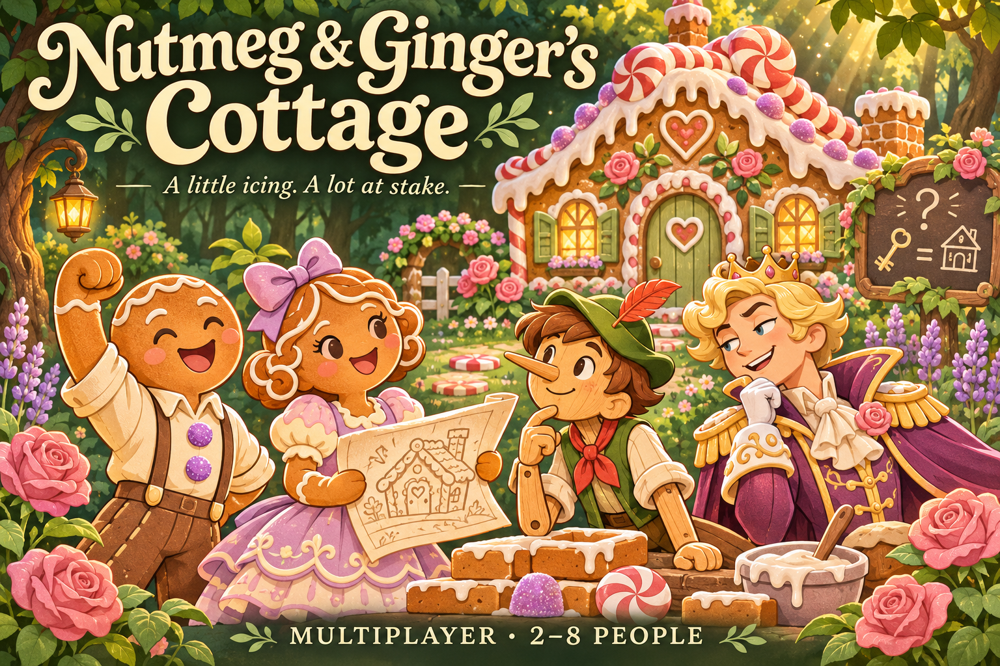
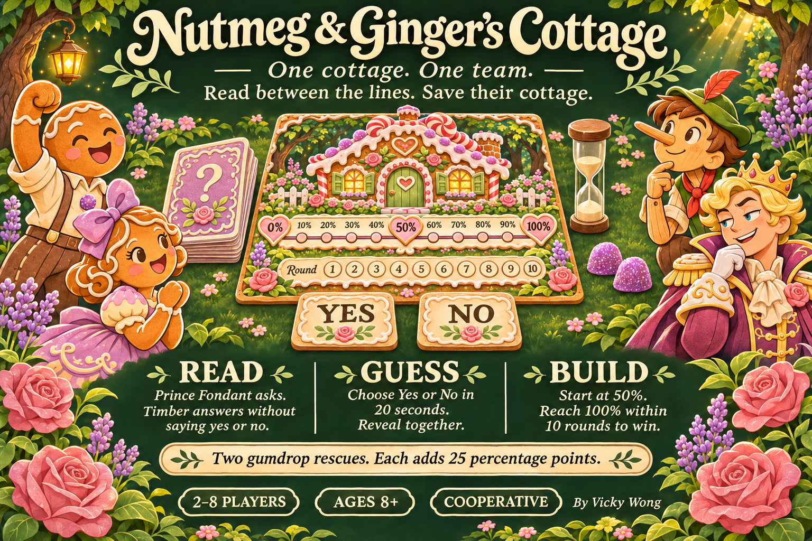
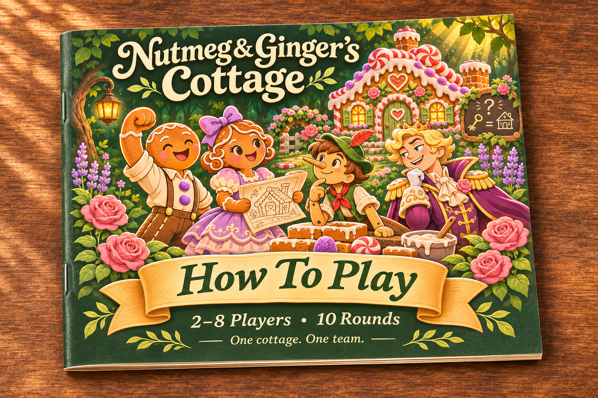
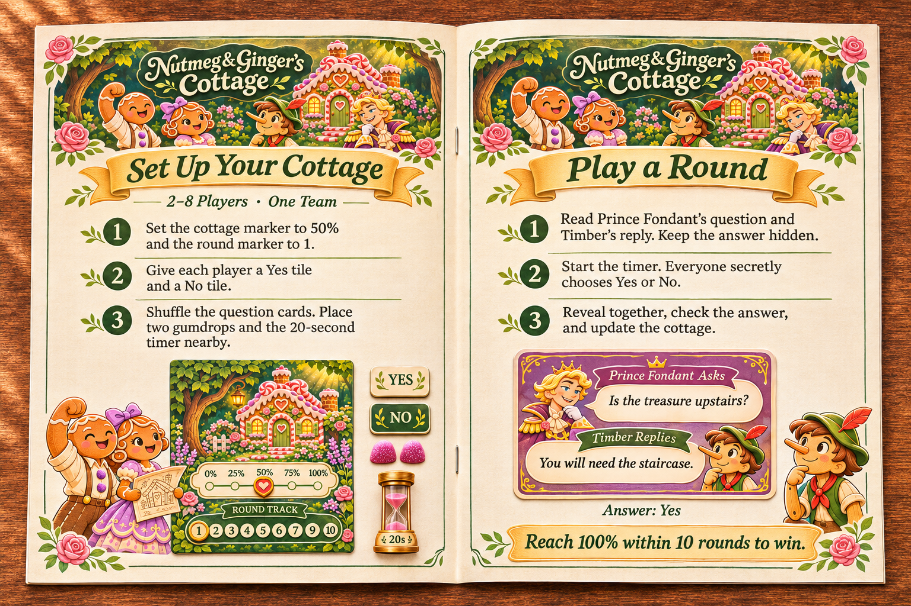
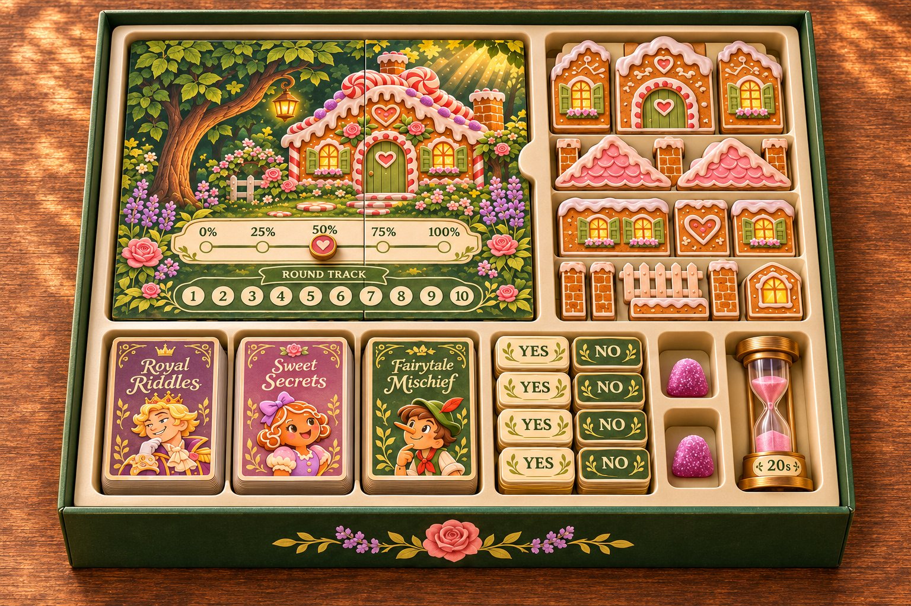
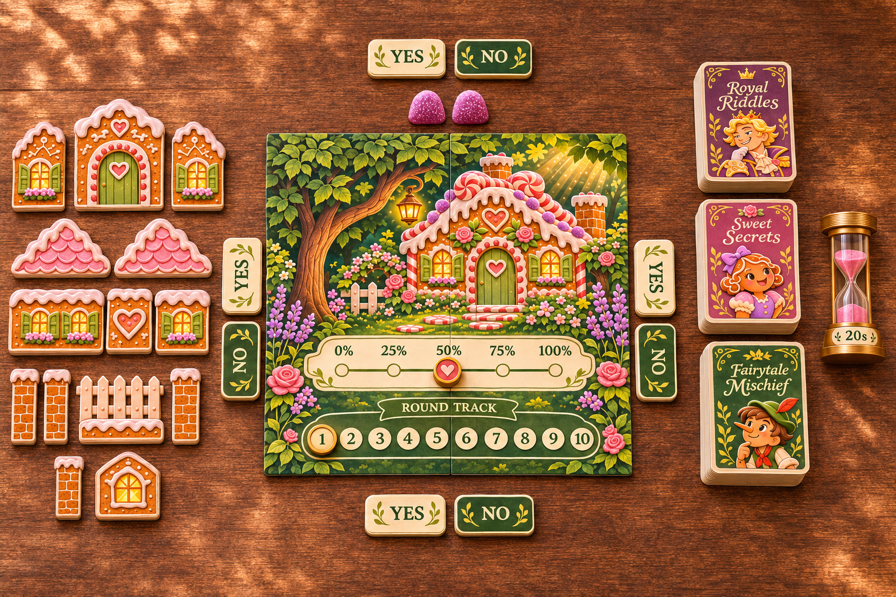
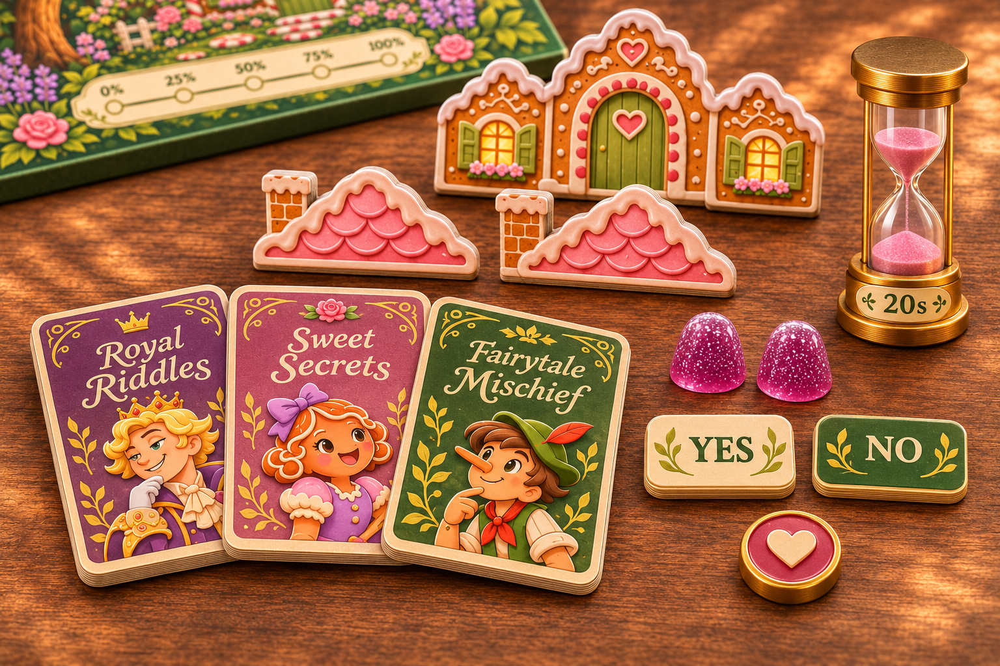
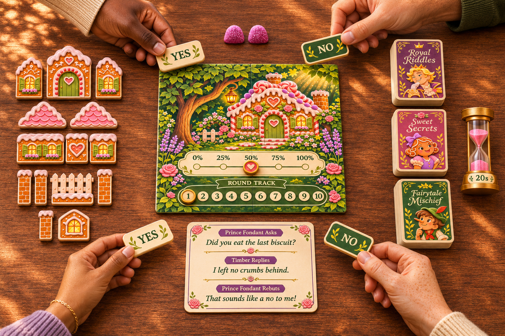
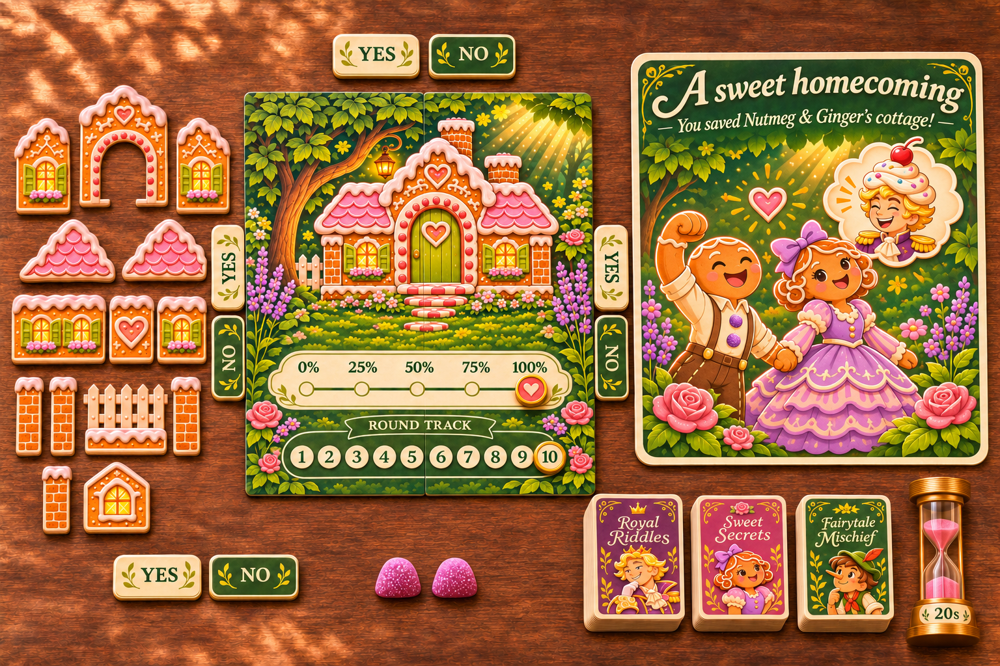
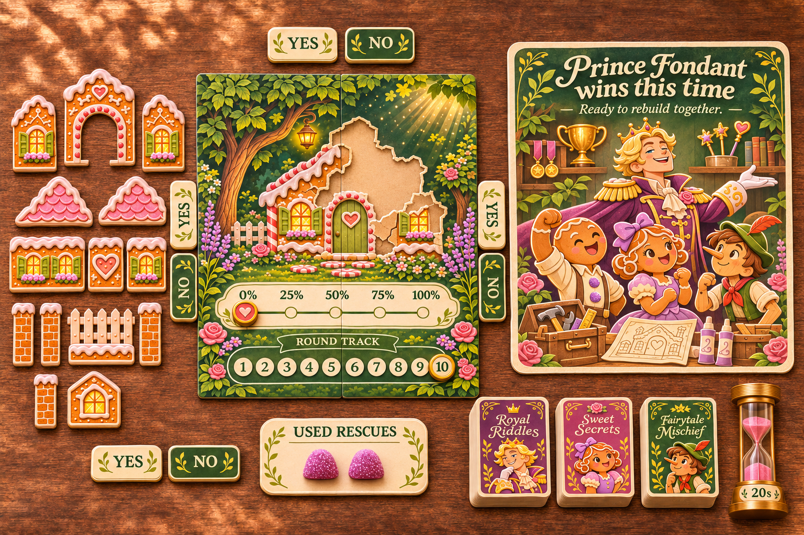

  <h1>🏠 Nutmeg &amp; Ginger’s Cottage: Board Game Edition</h1>

  
A cooperative fairytale board game concept built around logic riddles.

<h2>📑 Table of Contents</h2>

<ul>
  <li><a href="#objective">Objective</a></li>
  <li><a href="#inspiration">Inspiration</a></li>
  <li><a href="#project-details">Project Details</a></li>
  <li><a href="#story">The Story</a></li>
  <li><a href="#how-to-play">How To Play</a></li>
  <li><a href="#design">Board Game Design</a></li>
  <li><a href="#digital-edition">Digital Edition</a></li>
</ul>

<h2 id="objective">🎯 Objective</h2>

  This project reimagines Nutmeg &amp; Ginger’s Cottage as a physical board game for 2–8 players.
  It translates the digital game’s timed riddles, shared scoring, and gumdrop rescues into illustrated cards, voting tiles, and a cottage board.
  Created with ChatGPT, the concept explores packaging, components, instructions, and storytelling through a complete visual journey from opening the box to the final reveal.

<h2 id="inspiration">🎬 Inspiration</h2>

  The original game was inspired by the Shrek the Third scene where Pinocchio uses clever logic to avoid lying to Prince Charming.
  This edition brings that playful approach to deduction around a shared table, with the original characters Nutmeg, Ginger, Timber, and Prince Fondant.

<h3>Shrek the Third’s Pinocchio Tries to Lie Scene</h3>

<table>
  <tr>
    <td>
      
    </td>
  </tr>
</table>

<a href="https://youtu.be/2xhC2cbq7zA">Watch Video</a>

<h2 id="project-details">🛠️ Project Details</h2>

<strong>Tools:</strong> ChatGPT and AI image generation

<strong>Format:</strong> Physical board game concept and product mockups

<strong>Players:</strong> 2–8 people · Ages 8+ · Cooperative

<strong>Status:</strong> Visual concept; the images show an imagined physical edition.

<h2 id="story">📖 The Story</h2>

  Nutmeg and Ginger are building their dream cottage, but Prince Fondant has other plans.
  Timber never lies, yet his clever replies hide the answers your team needs.
  Read between the lines, trust your judgment, and build together before the prince turns their sweet home into crumbs.

  Save the cottage, and Prince Fondant’s attack backfires into a cupcake-hair makeover.
  Lose this time, and the builders gather their tools for another adventure.

<h2 id="how-to-play">🎲 How To Play</h2>

<h3>Find the Hidden Answer</h3>

  Read Prince Fondant’s question, Timber’s truthful reply, and the prince’s misleading rebuttal.
  Keep the answer hidden while each player privately chooses Yes or No using their voting tiles.
  Players have 20 seconds and may change their choice before time runs out, then reveal together.
  A missed choice is filled at random.

<h3>Build Together</h3>

  The team starts with one cottage at <strong>50%</strong>.
  Every player’s guess counts: correct guesses help build it, while wrong guesses help Prince Fondant hammer it down.

<ul>
  <li><strong>Everyone Correct:</strong> +20 Percentage Points.</li>
  <li><strong>Half Correct:</strong> +5 Percentage Points.</li>
  <li><strong>Everyone Wrong:</strong> −10 Percentage Points.</li>
</ul>

  For any team split, the change is <strong>30 × (correct guesses ÷ players) − 10 percentage points</strong>.

<h3>Save Their Cottage</h3>

  Reach <strong>100% within 10 rounds</strong> to win.
  The team has <strong>two gumdrop rescues</strong>, each adding <strong>25 percentage points</strong>.
  At 0%, play pauses so the team can choose a rescue and rebuild to 25%.
  If round 10 ends below 100%, remaining gumdrops can still save the cottage, but they do not add rounds.
  Prince Fondant wins if the team cannot save their cottage.

  The physical concept retains the digital rules. A production prototype still needs a precise scoring tracker, complete tabletop instructions, and component counts for all eight players.

<h2 id="design">🖼️ Board Game Design</h2>

  Forest green, buttercream, rose, lavender, and honey gold connect the box, cards, cottage pieces, and storybook instructions.
  The images follow the player’s experience: discover the box, explore the components, play together, and reveal the ending.

<h3>Front Cover</h3>

<table>
  <tr>
    <td>
      
    </td>
  </tr>
</table>

<h3>Back Cover</h3>

<table>
  <tr>
    <td>
      
    </td>
  </tr>
</table>

<h3>How To Play Booklet</h3>

<table>
  <tr>
    <td>
      
    </td>
  </tr>
</table>

<h3>Inside the Rulebook</h3>

<table>
  <tr>
    <td>
      
    </td>
  </tr>
</table>

<h3>Inside the Box</h3>

<table>
  <tr>
    <td>
      
    </td>
  </tr>
</table>

<h3>Ready to Play</h3>

<table>
  <tr>
    <td>
      
    </td>
  </tr>
</table>

<h3>Component Close-Up</h3>

<table>
  <tr>
    <td>
      
    </td>
  </tr>
</table>

<h3>A Round in Action</h3>

<table>
  <tr>
    <td>
      
    </td>
  </tr>
</table>

<h3>A Sweet Homecoming</h3>

<table>
  <tr>
    <td>
      
    </td>
  </tr>
</table>

<h3>Prince Fondant Wins This Time</h3>

<table>
  <tr>
    <td>
      
    </td>
  </tr>
</table>

<h2 id="digital-edition">🎮 Digital Edition</h2>

  This concept adapts the existing digital game into a tabletop experience.
  The digital edition remains a separate project.

  <a href="https://nutmeg-ginger-cottage.airyant14.chatgpt.site">Play Digital Game</a>
  &nbsp; • &nbsp;
  <a href="https://github.com/redefiningvicky/Nutmeg-Ginger-Cottage">View Digital Game Project</a>

  

    <a href="https://github.com/redefiningvicky/Vibe-Coding-Projects">Back to Vibe Coding Projects</a>
    &nbsp; • &nbsp;
    <a href="https://github.com/redefiningvicky/redefiningvicky">Back to Portfolio</a>
  

